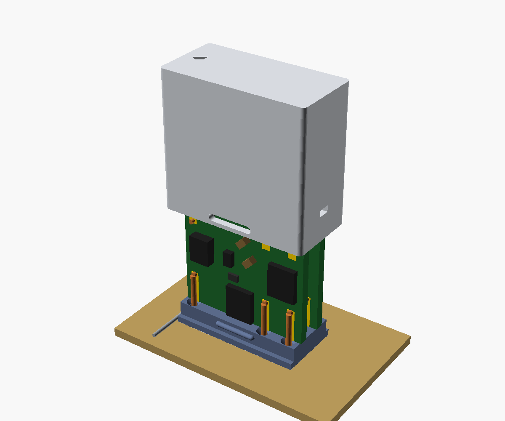
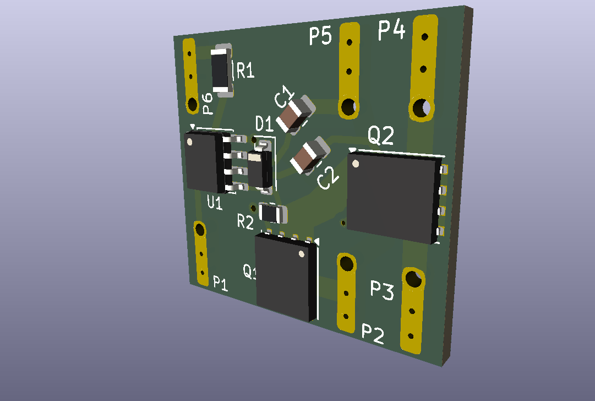

# Solid-state speaker relays for Pioneer receivers (XSR3012 / ASR7001 / FTR-F4AK024T)

A drop-in, solid-state replacement for the speaker relays in a family of Pioneer
AV and stereo receivers from the mid-2000s. Built and running in a **Pioneer VSX-816**.



## The problem

These receivers switch every speaker output through small Fujitsu relays
(**FTR-F4AK024T**, Pioneer part **XSR3012**, later superseded by **ASR7001**).
They are 2-Form-A, 24 V relays with silver-tin-oxide contacts, which are rated
for a **minimum load of 100 mA at 5 V**. Speaker signals at normal listening
levels sit well below that, so over the years the contacts film over.

> **About the part numbers:** XSR3012 and ASR7001 are **Pioneer service part
> numbers**, the ones you will find in the service manual parts lists.
> FTR-F4AK024T is the **manufacturer's part number** (Fujitsu, whose relay
> business is now FCL Components). ASR7001 is Pioneer's later replacement for
> XSR3012. Its manufacturer part number is not known.

Typical symptoms:

- After power-on, one or more speakers cut in and out, or drop in level, each
  channel on its own. This is worst at low volume.
- It clears up after the receiver has been on for a while.
- Headphones are unaffected, because the headphone feed is taken from the amp
  outputs before the relays.

Cleaning the contacts helps for a while. New relays are hard to find: the
FTR-F4 series was discontinued in 2021, and the replacement ASR7001 is out of
stock at the dealers I checked.

## What this is

Each relay is replaced by **two small cards, one per pole**, that stand in the
original relay's footprint and solder into its six holes. Each card is a MOSFET
switch driven by an isolated driver powered from the receiver's own relay-coil
drive. The receiver does not know the difference.

- Silent speaker switching: no clicking when changing listening modes (stereo
  to surround) or speakers A / B. The receiver still clicks once at power-on,
  but that is the separate AC power relay, which this does not replace.
- Contacts that cannot wear or film over: about 8 mΩ per pole.
- Fully isolated. The switch floats on the speaker signal and has no connection
  to the coil circuit.
- Uses the existing relay timing and protection. The receiver still decides
  when to connect the speakers.

### Circuit (per card = one pole)

| Part | Value / type | Notes |
|---|---|---|
| U1 | Si8752AB-IS (SOIC-8) | Isolated FET driver, diode-emulator input |
| Q1, Q2 | BSC040N10NS5 (TDSON-8) | 100 V, 4 mΩ, source-to-source (blocks both polarities) |
| D1 | BZT52C15 (SOD-123) | 15 V gate clamp |
| R2 | 1 MΩ | Gate-source pull-down |
| C1, C2 | 10 pF C0G, 100 V (0805) | Gate-to-drain |
| R1 | 1 kΩ (1206) | Sets input current |

The two cards' inputs are wired in series across the coil pins:
(24 V − 2 × 2.2 V) / 2 kΩ ≈ **10 mA**. The amp rails on the VSX-816 are about
±56 V, well inside the 100 V MOSFET rating.

Card size is 24 × 22 mm, 1.6 mm FR-4, single-sided assembly (JLCPCB).



## Compatible receivers

Compatibility is decided by **the relay part number**, not the model name. Look
in your receiver's service manual parts list (usually the POWER PACK ASSY) for
**XSR3012** or **ASR7001** on the speaker relays.

Confirmed from service-manual parts lists:

| Model | Relays | Part |
|---|---|---|
| VSX-816, VSX-916 | RY751, RY752, RY753, RY501 | XSR3012 |
| SX-316 | RY751, RY752, RY753, RY501 | XSR3012 |
| SX-218 | (same service manual as SX-316) | XSR3012 |
| VSX-416 | RY751, RY752, RY753 | XSR3012 |
| VSX-516 | RY501 (one board variant; shares manual with VSX-416) | XSR3012 |
| VSX-417 | RY751, RY752, RY753 | ASR7001 |

**Built and tested only in the VSX-816.** The other models use the same relay
with the same reference numbers and board positions, so it should drop in, but
nobody has tried yet. If you build it for another model, please open an issue
with your results.

ASR7001 also appears in some older Pioneer models (late-1990s VSX-xxxRDS
and VSX-D series). These are not verified. Check the parts list and the coil
voltage first.

### Before you build: measure the coil drive

On the VSX-816 the coil sees about **24 V with pin 6 positive** (pin 6 =
+12 V, pin 1 pulled to −12 V when the relay is on). Pin numbering follows the
Fujitsu datasheet (bottom view): coil 1–6, pole A 2–3, pole B 5–4. Pins 2 and 5
are the moving blades; 3 and 4 are the fixed contacts.

With the receiver on and speakers connected, measure pin 6 to pin 1 on one of
the original relays. You should see about +24 V. If pin 1 is the positive one,
or the voltage is very different, stop and open an issue. The cards' inputs are
polarized (they act like LEDs) and R1 is sized for 24 V.

## Repository layout

```
hardware/kicad/    KiCad 10 project with its symbol and footprint libraries
hardware/jlcpcb/   Gerber zip, BOM and placement files, ready to upload
case/              Printable case: relay_case_cover.stl, relay_case_base.stl,
                   and the OpenSCAD source (relay_case.scad)
docs/BUILD.md      Step-by-step build and install guide
docs/IMPROVEMENTS.md  What I would change for a second revision
```

## Ordering

1. Upload `hardware/jlcpcb/relay-ssr-gerbers.zip` to JLCPCB. Use 1.6 mm, any
   colour, HASL.
2. Choose PCB assembly (top side). Upload `bom.csv` and `positions.csv` from
   the same folder.
3. Check the placement preview before paying: U1, Q1 and Q2 pin 1, and the
   cathode band of D1 at the GATE end.
4. Some parts may need JLC's Global Sourcing. Stock substitutions used on the
   first order: C1/C2 KEMET C0805C100J1GACTU, D1 BZT52C15, U1 Si8752AB-ISR
   (reel version of the same part).

Each relay needs **two cards**. A VSX-816 has four speaker relays, so it needs
eight cards. JLC's minimum of 10 boards leaves two spares.

## Safety

You are working inside a mains-powered amplifier with large filter capacitors.
**Unplug the receiver and give the capacitors time to discharge** before
touching the board. Check the rails with a meter if unsure. Desoldering the
original relays and fitting these is ordinary through-hole work, but the board
is cramped.

This is a hobby project shared as-is, with no warranty. Build and use it at your
own risk.

## License

Hardware (KiCad files, case files): **CERN-OHL-P v2**. Documentation:
**CC BY 4.0**. You can build, modify and sell it. Please keep the credit.

GitHub username: glotim
