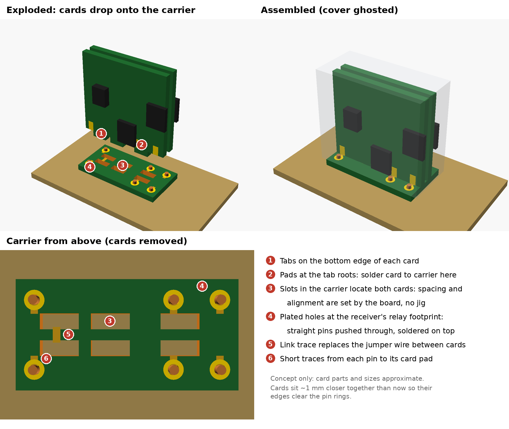

# Ideas for a second revision (not built or tested)

The first build works, but assembling the pins by hand is fiddly and easy to get
wrong. If you build this and want to improve it, these are the changes I would
make. **None of these have been built.** Treat them as a starting point.

## 1. Replace the printed base with a carrier PCB

This is the biggest improvement. A small horizontal PCB replaces the printed
base, and both cards stand on it.

- The six pin holes are **plated through-holes at the receiver's footprint**
  (columns 0 / 15 / 20 mm, rows 7.5 mm apart). Straight pins push through and
  solder on top, so the pitch and alignment are automatic. There is no
  swaging, bending or crushing, and no plastic near the iron.
- The cards have tabs on their bottom edge that drop into **slots in the
  carrier**. The slots set the card spacing and keep the cards square, so no
  jig is needed.
- Each card's bottom pads solder to carrier pads in a simple right-angle joint.
- The link between the two cards becomes a **trace on the carrier**, so the
  separate jumper wire goes away.
- The cards need to sit about 1 mm closer together than in rev A, about 1.3 mm
  between their bare backs, so their edges clear the pin pads. The other
  option is to notch the card bottoms around the pads.
- JLC can panel the carrier with the cards in one order.

### Holding the cover on

- Notch each **end** of the carrier under the card ends, about 1.5 mm deep and
  4.5 mm wide, so the card bottom edges span open space there.
- A flexible finger in each **end wall** of the cover reaches down into the
  notch and hooks **under the card edge**. One finger per end catches both
  cards. PETG flexes well for this.
- The pins at the coil end are at y = ±3.75 mm, so a notch spanning y =
  ±2.25 mm clears their pads by about 0.4 mm.

### Carrier height

Solder fillets form under the carrier where the pins pass through, so the
carrier should sit about 0.5 mm above the receiver board rather than flat on
it. To set this evenly, extend the cover walls down to the receiver board as
**feet**. Assemble the relay with the cover on, press until the feet are flat
on the board, then solder from underneath. Notch the feet over any jumper wire
on the receiver board beside the footprint (the VSX-816 has one at the coil
end).

The overall height ends up lower than rev A, because the printed base puts the
cards about 3.8 mm up.

Rough concept geometry is in `docs/revB_carrier_concept.scad`.

## 2. Cover changes

- **Card guides on the end walls instead of slots in the roof.** Small
  rectangular rails about 6 mm (1/4") long run down from the roof on each end
  wall, forming a slot for each card end, with a 45° chamfered lead-in at the
  bottom. These print cleanly in the roof-down orientation, unlike the shallow
  roof slots, and the roof can then be solid. Parts on the cards must stay
  about 1.5 mm back from the card ends in the top 6 mm.
- **Vents:**
  - None on top.
  - Rotate the side vents 90° so they are vertical slots.
  - Ends: one low and one about 1/4" (6 mm) below the top.
  - Long sides: three low, evenly spaced, and three about 1/4" below the top.

  Vertical slots also avoid the weak horizontal band that broke an early
  print.

## 3. Card layout

- Move parts **further back from the pin pads**, about 2.5–3 mm clear, so
  pliers and the iron tip can reach. (With a carrier PCB this matters less.)
- Add **solder mask between adjacent pads** and make the pads a little
  narrower, to stop solder bridging.
- Keep component pins clear of the top edge and the vents. On rev A, one
  MOSFET pin sits close to the top.
